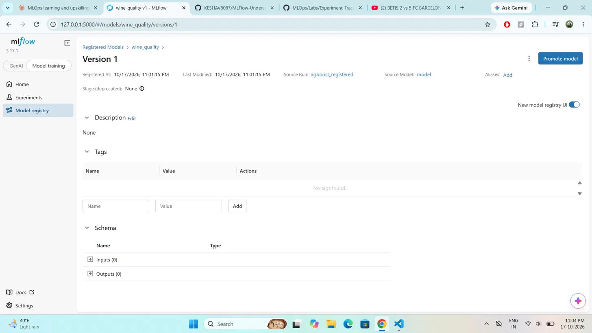

# MLOps Lab: MLflow Experiment Tracking, Model Registry, and Batch Inference

This lab uses MLflow to track machine learning experiments, register a chosen
model in the MLflow Model Registry, and run batch inference with the registered
model. It is based on the Wine Quality Prediction lab, adapted to run locally
and extended with my own modifications.

## Problem

Predict whether a wine is high quality (quality score of 7 or above) from its
physicochemical measurements. Red and white wine datasets are combined into one,
with an indicator column for wine type. This is a binary classification problem,
and the classes are imbalanced: only about 20 percent of wines are high quality.

## Pipeline

1. `fetch_data.py` - downloads the red and white wine datasets from the UCI
   Machine Learning Repository into the `data` folder.
2. `preprocess.py` - combines the datasets, adds an `is_red` indicator, cleans
   column names, defines the `high_quality` target, and saves a processed CSV.
3. `train.py` - trains two models and logs each as an MLflow run with parameters
   and metrics.
4. `register_model.py` - registers the chosen model in the MLflow Model Registry.
5. `batch_inference.py` - adds a production alias and runs batch inference using
   the registered model.

## Experiment tracking

Two models are trained and compared as separate MLflow runs:

- Random Forest (baseline)
- XGBoost

For each run, three metrics are logged: AUC (Area Under the ROC Curve), accuracy,
and F1 score. Multiple metrics are logged deliberately, because accuracy alone is
misleading on imbalanced data. The comparison showed the random forest with a
slightly higher AUC, and XGBoost with a higher F1 score, so XGBoost was chosen as
the model to register.

## Model registry

The XGBoost model is registered as `wine_quality` version 1. A `production` alias
is attached to that version, which is the modern replacement for the deprecated
stage transitions. Batch inference loads the model by its alias
(`models:/wine_quality@production`) rather than a hardcoded version.

## My modifications to the original lab

- Added a second model (XGBoost) and compared it against the Random Forest
  baseline, instead of training only one model.
- Logged additional metrics (accuracy and F1) alongside AUC.
- Dropped the raw `quality` column from the model inputs to prevent data leakage,
  since the target was derived from it.
- Reimplemented batch inference in plain Python (pandas and MLflow) instead of the
  original Spark and Databricks version, so it runs locally.
- Used a model alias instead of the deprecated stage transition, and adapted the
  model logging for MLflow version 3.

## How to run

1. Create a virtual environment and install dependencies:
   `pip install -r requirements.txt`
2. Fetch and preprocess the data:
   `python fetch_data.py`
   `python preprocess.py`
3. Train and log the models:
   `python train.py`
4. Register the model:
   `python register_model.py`
5. Run batch inference:
   `python batch_inference.py`
6. View experiments and the registry in the MLflow UI:
   `mlflow ui`

## Note on MLflow version

This lab was written for an older MLflow. It has been adapted for MLflow 3,
including the model logging approach and the use of aliases in place of stages.

## Evidence

Registered model in the MLflow Model Registry (wine_quality, version 1):

